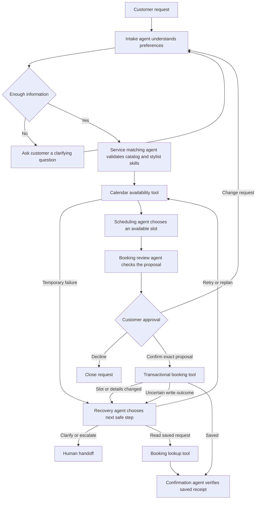

# Salon Desk

Salon Desk helps a salon customer turn a service request into an approved appointment. Six local AI specialists handle intake, service matching, scheduling, booking review, recovery and confirmation. LangGraph coordinates the steps and human approval. SQLite stores actual local sample bookings.

This is the custom use case option in the Week 3 Build Your AI Agent handout, implemented with Python and LangGraph.

## Run locally

Install Python 3.11 or newer and Ollama. Download the local model once.

```powershell
ollama pull llama3.2:3b
python -m venv .venv
.\.venv\Scripts\python.exe -m pip install -r requirements.txt
.\.venv\Scripts\python.exe -m streamlit run app.py --server.address 127.0.0.1 --server.port 8502
```

Ollama must be running on its normal local address, 127.0.0.1:11434. The app opens at http://127.0.0.1:8502/. There are no API keys. Inference runs locally. You can choose a different locally installed compatible model through the SALON_MODEL environment variable.

## Try the workflow

Enter a sample customer name, choose tomorrow's date and request a haircut at 2 PM with Maya. Click Find my appointment. Review the proposed service, stylist, time, duration and USD price. Confirm the proposal to create a booking, or decline it. The Change my request section can request a different date or time.

The sidebar's Demonstrate recovery section offers three independent fault injections. Select them before starting a new request.

- Calendar lookup fails once. The recovery agent chooses between a bounded retry and a human handoff.
- Slot is taken after approval. A separate local transaction simulates another customer's booking. The recovery agent chooses a fresh plan or a handoff. A new proposal requires new customer approval.
- Booking response is interrupted. The booking commits, then the graph simulates losing the confirmation response. The recovery agent requests a lookup of the saved request. This read resolves the outcome before another write can be attempted.

The salon, services, prices and stylist schedules are sample data. AI calls and database operations execute for real. The recovery agent is used when a problem occurs. A normal booking uses the other five specialists. Fault injections are explicitly labeled in the activity log. No external salon is contacted.

## Architecture



Model failures receive one automatic retry, followed by a persistent human handoff. A real calendar outage receives up to three attempts before handoff. Empty availability asks the customer to change their request. Unexpected programming errors surface for diagnosis.

Each of the six specialists uses a separate role prompt and validated JSON schema. They share the same local model, while their context, responsibility and graph node differ. The service matching output must agree with the actual catalog. Recovery choices are bounded by allowed actions and retry budgets. Confirmation fields must match the saved booking. The orchestrator is the LangGraph state machine.

The matching agent receives an explicit qualified-stylist list and one repair attempt if it returns inconsistent details. Scheduling receives the best three available candidates, and a deterministic preference check prevents a worse AI choice from displacing the requested opening. Review receives the selected service and stylist records. These bounds reduce local-model processing time and keep facts tied to the tools.

## State and booking integrity

The app stores calendar records in .salon-data/salon.sqlite and graph checkpoints in .salon-data/workflow.sqlite beside the source files. Keep the request URL to reopen a pending approval or confirmed result. Data persists until the owner removes the local project data. This is a single-user local demonstration application.

Approval names a unique proposal ID. Any changed proposal must receive new approval. Before inserting a booking, SQLite obtains a write transaction, checks the current service details and overlapping intervals, and enforces a unique request ID. A retry after a committed write returns the existing reservation.

The interface does not collect payment details or send messages. Exported confirmations and activity logs can be saved by the user.

## Verification

```powershell
.\.venv\Scripts\python.exe -m unittest -v test_booking
```

The regression suite uses a test model fixture to isolate workflow and transaction behavior, including old checkpoint compatibility and confirmation failure after a committed booking. The actual local model is also checked end to end. See the included sample activity and confirmation for the model roles and measured runtime.

Reference documentation is available for [LangGraph interrupts](https://docs.langchain.com/oss/python/langgraph/interrupts) and [Ollama structured outputs](https://docs.ollama.com/capabilities/structured-outputs).
